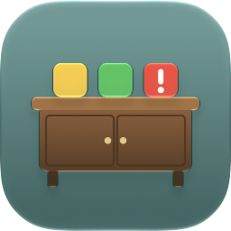

<div align="center">
  <h1>
    <br>
    Sideboard
  </h1>
  <p>Keeps track of when sideloaded iOS apps expire,<br>with reminders to rebuild them before they stop launching.</p>
</div>

---

- **`Sources/SideloadKit/`**: a Swift package that each app calls at launch with `SideloadReporter.report()`. It reads the app's `embedded.mobileprovision` and saves the install and expiry dates to the shared App Group `group.se.haydenblai.sideload`.
- **`Sideboard/`**: the dashboard app. It lists every reporting app by expiry date and sends notifications 14, 7 and 1 days before an app expires.

## Adding an app
1. Add the App Group `group.se.haydenblai.sideload` to the app target.
2. Add this repo as a package dependency (File → Add Package Dependencies, `https://github.com/HaydenBL/Sideboard`, branch `master`) and link `SideloadKit` to the app target.
3. Call `SideloadReporter.report()` at launch.

## App icon
The icon lives in `Sideboard/Sideboard/Sideboard.icon` (an Icon Composer bundle). After changing it, re-render the README image:

```sh
"/Applications/Xcode.app/Contents/Applications/Icon Composer.app/Contents/Executables/ictool" \
  Sideboard/Sideboard/Sideboard.icon --export-preview iOS Light 256 256 1 docs/icon.png
```
